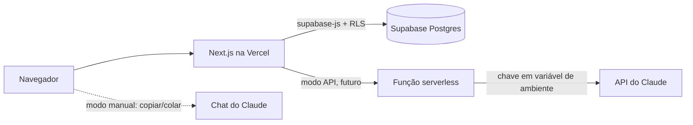

# 02 — Arquitetura

## Visão geral

| Camada | Escolha | Observação |
|---|---|---|
| Front-end e servidor | Next.js na Vercel (plano Hobby) | Custo zero |
| Banco e autenticação | Supabase (plano gratuito) | Postgres + Auth + RLS |
| Revisão espaçada | `ts-fsrs` | Implementação de referência do FSRS em TypeScript |
| Mapas mentais | Markmap | Gera o mapa a partir do Markdown do resumo |
| IA | Modo manual por padrão | Ver ADR-002 |

## Restrições do plano gratuito do Supabase

- Projeto pausa após 7 dias sem uso. Com estudo diário, isso não ocorre; se ocorrer, o runbook de implantação descreve a reativação.
- Sem backup automático e sem download de backup pelo painel. **Ação:** rotina semanal manual com `npm run backup` (`supabase db dump`), mais um backup antes de cada migração aplicada no remoto, com cópia criptografada no Google Drive e ensaio de restauração periódico. Ver [operacao/backup-e-restauracao.md](operacao/backup-e-restauracao.md) e o ADR-008.
- Limites do plano: 500 MB de banco e 2 projetos ativos no Supabase; uso não comercial na Vercel Hobby. Para um usuário, a folga é grande.

## Implantação

- **Regiões:** Supabase em `sa-east-1` (São Paulo) e funções da Vercel em `gru1` (`vercel.json`), juntos, para o banco ficar perto da função. Se o plano Hobby não permitir escolher a região, o plano B é Supabase em `us-east-1` e funções em `iad1` (SPEC-002, P-1).
- **Código:** a Vercel implanta automaticamente só a `main`, pela integração Vercel–GitHub; não há previews por PR. A `main` só recebe merge por pull request com o check `verify` verde. Reversão pelo "Promote" da implantação anterior no painel da Vercel.
- **Banco:** as migrações são aplicadas no remoto pelo dono do projeto, da máquina local, com `npm run db:push` (guardas e confirmação digitando o identificador do projeto), antes do merge, e conferidas com `npm run db:test:remote`. O GitHub Actions não aplica migração nem tem segredo de banco (repositório público). A homologação é o Supabase local.
- **Variáveis:** na Vercel entram só `NEXT_PUBLIC_SUPABASE_URL` e `NEXT_PUBLIC_SUPABASE_PUBLISHABLE_KEY`. A senha do banco remoto vive no gerenciador de senhas e na sessão do terminal.
- **Verificação:** `npm run check:prod` confere, sem credenciais, redirecionamento, cabeçalhos, cadastro desligado e acesso anônimo negado às tabelas.
- Passo a passo em [operacao/implantacao.md](operacao/implantacao.md); decisão em [ADR-008](adr/ADR-008-implantacao-e-backup-locais.md).

## Modos de IA

Toda funcionalidade de IA passa por uma interface única, e o modo configurado escolhe a implementação (ver ADR-002):

| Modo | Comportamento |
|---|---|
| `desligado` | Funções de IA ficam ocultas |
| `manual` | A plataforma gera o prompt; o usuário cola no chat do Claude e importa a resposta |
| `api` | Função serverless chama a API do Claude (não implementado no MVP) |

Cada interação fica registrada em `ia_solicitacoes`, com prompt, resposta bruta e status.

## Segurança

- **Chaves de API** nunca no front-end nem no repositório; apenas em variável de ambiente do servidor.
- **RLS** ativa em todas as tabelas (ver ADR-005).
- **Chave `service_role` do Supabase** usada somente em scripts locais de carga, nunca na aplicação.
