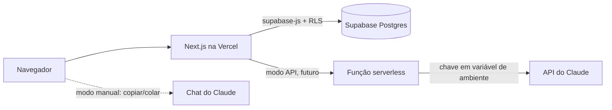

# 02 — Arquitetura

## Visão geral

| Camada | Escolha | Observação |
|---|---|---|
| Front-end e servidor | Next.js na Vercel (plano Hobby) | Custo zero |
| Banco e autenticação | Supabase (plano gratuito) | Postgres + Auth + RLS |
| Revisão espaçada | `ts-fsrs` | Implementação de referência do FSRS em TypeScript |
| Mapas mentais | Markmap | Gera o mapa a partir do Markdown do resumo |
| IA | Modo manual por padrão | Ver ADR-002 |

## Restrições do plano gratuito do Supabase

- Projeto pausa após 7 dias sem uso. Com estudo diário, isso não ocorre.
- Sem backup automático. **Ação:** rotina semanal de exportação (`pg_dump` ou exportação pelo painel), a ser criada junto com o MVP.

## Modos de IA

Toda funcionalidade de IA passa por uma interface única, e o modo configurado escolhe a implementação (ver ADR-002):

| Modo | Comportamento |
|---|---|
| `desligado` | Funções de IA ficam ocultas |
| `manual` | A plataforma gera o prompt; o usuário cola no chat do Claude e importa a resposta |
| `api` | Função serverless chama a API do Claude (não implementado no MVP) |

Cada interação fica registrada em `ia_solicitacoes`, com prompt, resposta bruta e status.

## Segurança

- **Chaves de API** nunca no front-end nem no repositório; apenas em variável de ambiente do servidor.
- **RLS** ativa em todas as tabelas (ver ADR-005).
- **Chave `service_role` do Supabase** usada somente em scripts locais de carga, nunca na aplicação.
