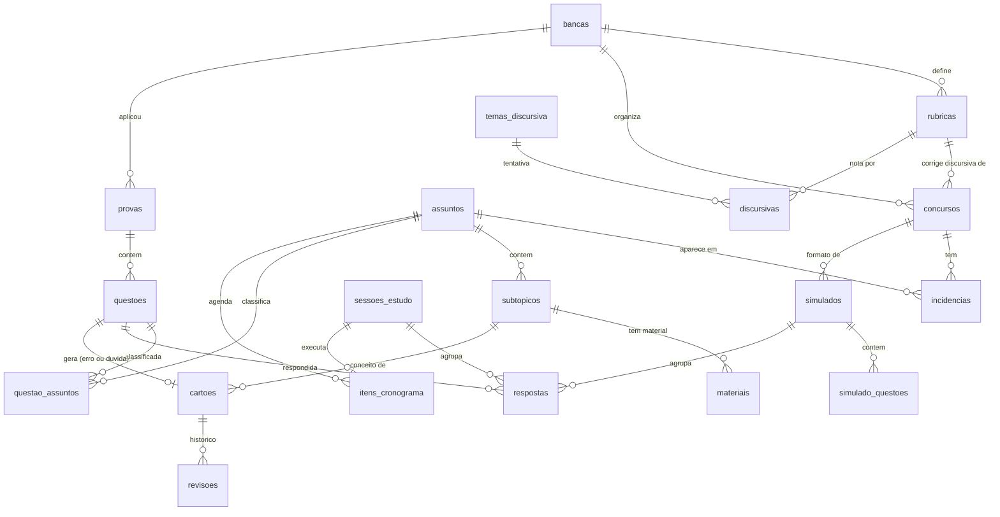

# 03 — Modelo de dados

Migração: `supabase/migrations/20261116000000_schema_inicial.sql`
Validação: aplicada com sucesso em PostgreSQL 16 junto com o seed; teste de RLS e de restrições executado.

## Visão geral

São 21 tabelas em 6 blocos, mais 2 visões.

| Bloco | Tabelas | Natureza |
|---|---|---|
| Referência | `bancas`, `rubricas`, `concursos`, `assuntos`, `subtopicos`, `incidencias` | Carregadas pelo seed; mudam a cada novo edital |
| Conteúdo | `materiais`, `provas`, `questoes`, `questao_assuntos` | Cresce com importações |
| Estudo | `configuracoes`, `sessoes_estudo`, `itens_cronograma`, `simulados`, `simulado_questoes`, `respostas` | Atividade do usuário |
| Memorização | `cartoes`, `revisoes` | Estado e histórico FSRS |
| Discursivas | `temas_discursiva`, `discursivas` | Temas e tentativas corrigidas |
| IA | `ia_solicitacoes` | Registro de prompts e respostas |

## Diagrama

## Tabelas

### Referência

**`bancas`** — Fumarc, FCC, IBFC, Cebraspe. `penalidade_erro` guarda quanto um erro desconta (Cebraspe = 1).

**`rubricas`** — critérios de correção da discursiva em `definicao` (JSON), extraídos dos editais. Formatos diferentes por banca:
- Fumarc: critérios com faixas (0 a 15) e desconto de 1 ponto por erro.
- FCC: critérios com pontuação máxima fracionada (total 10).
- IBFC: estrutura 10, conteúdo 20, expressão 10.
- Cebraspe: fórmula `NPD = NC − 4 × NE / TL` (e variante técnica `− 6 × NE / TL`).

**`concursos`** — um registro por edital analisado. `objetiva` e `discursiva` em JSON porque o formato varia muito entre bancas (distribuição por disciplina, pesos, itens C/E, notas mínimas). `peso_alvo` define a importância do concurso na prioridade.

**`assuntos`** — a taxonomia (chave textual estável, ex.: `pdpj_stack`). `perfil` (sistemas, infra, comum) separa a lacuna de infraestrutura; `fase` separa o que se estuda antes e depois do edital.

**`subtopicos`** — divisão de cada assunto; é a unidade a que se prendem materiais e cartões de conceito.

**`incidencias`** — matriz assunto × concurso, com valor 0, 0,5 ou 1.

### Conteúdo

**`materiais`** — resumo (Markdown), link ou anotação por subtópico. `verificado` indica se foi conferido com a fonte oficial; `versao` sobe a cada correção.

**`provas`** — metadados da prova de origem. Uma prova pode não pertencer a um concurso-alvo (ex.: prova de TI de outro órgão usada para treino).

**`questoes`** — enunciado, alternativas (JSON), gabarito e comentário. Restrição garante coerência entre formato e gabarito. `hash_conteudo` impede importação duplicada. `texto_base` comporta itens Cebraspe que compartilham um mesmo cenário.

**`questao_assuntos`** — uma questão pode cobrir mais de um assunto.

### Estudo

**`configuracoes`** — uma linha por usuário: concurso-alvo, horas por dia da semana, cota semanal mínima de infraestrutura, novos cartões por dia, retenção desejada do FSRS e modo de IA.

**`itens_cronograma`** — o plano do dia, gerado pela aplicação. Quando executado, aponta para a `sessoes_estudo` correspondente.

**`sessoes_estudo`** — o que de fato foi estudado, com início e fim (base para "planejado × realizado").

**`simulados`** e **`simulado_questoes`** — a montagem segue a distribuição do concurso; `disciplina` permite calcular nota por disciplina.

**`respostas`** — cada resposta, com `confianca` (chute, dúvida, certeza) e tempo. Resposta em branco: `resposta` e `correta` nulos (relevante no Cebraspe).

### Memorização

**`cartoes`** — dois tipos: `questao` (aponta para uma questão) e `conceito` (frente e verso livres, ligados a um subtópico). As colunas de estado espelham o `Card` da `ts-fsrs` para gravação direta. Índice parcial acelera a fila diária (`due` dos cartões não suspensos). Há no máximo um cartão por questão por usuário.

**`revisoes`** — log de cada revisão (espelha o `ReviewLog` da `ts-fsrs`). Guardar o histórico completo permite, no futuro, otimizar os parâmetros do FSRS com os dados do próprio usuário.

### Discursivas

**`temas_discursiva`** — enunciado, textos de apoio e, quando houver, padrão de resposta da banca.

**`discursivas`** — cada texto escrito, com número de linhas, tempo e nota por critério da rubrica usada.

### IA

**`ia_solicitacoes`** — registra o prompt gerado, a resposta colada (modo manual) e o status da importação. Serve de trilha de auditoria para conteúdo gerado por IA.

## Visões

| Visão | O que calcula |
|---|---|
| `v_prioridade_assunto` | Soma de `peso_alvo × incidência` nos concursos ativos |
| `v_desempenho_assunto` | Taxa de domínio dos últimos 60 dias por assunto; acerto com confiança "chute" não conta |

As duas usam `security_invoker = true`, para respeitar a RLS de quem consulta.

A **retenção estimada** (retrievability do FSRS) não é calculada em SQL: depende da fórmula da `ts-fsrs` e é calculada na aplicação.

## Carga inicial

1. A fonte da verdade é `data/seed/taxonomia_tribunais_ti_v0.1.json`.
2. `python scripts/gerar_seed.py` gera `supabase/seed.sql` (idempotente: pode rodar de novo sem duplicar).
3. Resultado: 4 bancas, 4 rubricas, 4 concursos, 36 assuntos, 194 subtópicos, 144 incidências.

Para alterar a taxonomia, edite o JSON e gere o seed de novo; não edite o `seed.sql` à mão.

## Decisões de modelagem

| Decisão | Motivo |
|---|---|
| Chaves textuais em tabelas de referência (`trt3`, `pdpj_stack`) | Legíveis, estáveis e usadas no JSON de origem |
| UUID nas tabelas de atividade | Padrão do Supabase; sem colisão em importações |
| JSON para formato de prova e rubricas | Formatos muito diferentes entre bancas; evita dezenas de colunas opcionais |
| `user_id` com padrão `auth.uid()` mesmo sendo uso pessoal | RLS simples hoje; multiusuário possível no futuro sem migração grande |
| Estado FSRS como colunas, não JSON | Permite índice na data de vencimento e consultas de fila eficientes |
