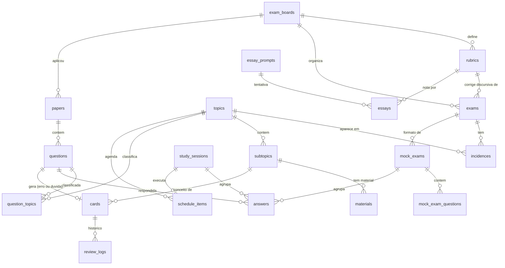

# 03 — Modelo de dados

Migrações (em ordem):
- `supabase/migrations/20261116000000_initial_schema.sql` — schema do MVP.
- `supabase/migrations/20261117000000_settings_theme.sql` — preferência de tema em `settings` (SPEC-001).
- `supabase/migrations/20261117010000_essay_type_questions_and_case_study.sql` — valor `technical_questions_and_case_study` no enum `essay_type`, para a discursiva da Vunesp no TJSP (questões dissertativas e estudo de caso na mesma etapa).

Validação: `npm run db:test` (pgTAP em `supabase/tests/`) após `supabase db reset`. `rls.test.sql` cobre a RLS das 21 tabelas (anônimo sem acesso, isolamento entre usuários nas tabelas pessoais e filhas, escrita autenticada nas de referência) e o `security_invoker` das 2 visões; `settings_theme.test.sql` cobre o enum `theme_preference` e a coluna `settings.theme`; `schema_constraints.test.sql` cobre os valores dos enums, as restrições `check` e o formato do seed.

## Visão geral

São 21 tabelas em 6 blocos, mais 2 visões.

| Bloco | Tabelas | Natureza |
|---|---|---|
| Referência | `exam_boards`, `rubrics`, `exams`, `topics`, `subtopics`, `incidences` | Carregadas pelo seed; mudam a cada novo edital |
| Conteúdo | `materials`, `papers`, `questions`, `question_topics` | Cresce com importações |
| Estudo | `settings`, `study_sessions`, `schedule_items`, `mock_exams`, `mock_exam_questions`, `answers` | Atividade do usuário |
| Memorização | `cards`, `review_logs` | Estado e histórico FSRS |
| Discursivas | `essay_prompts`, `essays` | Temas e tentativas corrigidas |
| IA | `ai_requests` | Registro de prompts e respostas |

## Diagrama

## Tabelas

### Referência

**`exam_boards`** — Fumarc, FCC, IBFC, Cebraspe, Vunesp, FGV e Instituto AOCP. `wrong_answer_penalty` guarda quanto um erro desconta (Cebraspe = 1).

**`rubrics`** — critérios de correção da discursiva em `definition` (JSON), extraídos dos editais. Formatos diferentes por banca:
- Fumarc: critérios com faixas (0 a 15) e desconto de 1 ponto por erro.
- FCC: critérios com pontuação máxima fracionada (total 10).
- IBFC: estrutura 10, conteúdo 20, expressão 10.
- Cebraspe: fórmula `NPD = NC − 4 × NE / TL` (e variante técnica `− 6 × NE / TL`).
- FCC, redação do TRT-2: conteúdo 4, estrutura 3, expressão 3 (total 10).
- FCC, estudo de caso (TRT-1, TRT-15, TRF-4): nota de 0 a 10 por questão; número de questões e limite de linhas ficam no concurso.
- Vunesp (TJSP): 6 questões dissertativas de 0,36 e 1 estudo de caso de 0,84 (total 3; tipo `technical_questions_and_case_study`).
- FGV (TJRJ): 1 questão discursiva de 20 pontos (tipo `technical_question`).
- Instituto AOCP (TRF-2): por estudo de caso, conhecimento técnico 6, argumentação 2, língua 2 (total 10).

Concursos sem discursiva (TJRS, TJSC, TRT-12) têm `essay` e `rubric_id` nulos.

**`exams`** — um registro por edital analisado (14 na v0.2). `objective` e `essay` em JSON porque o formato varia muito entre bancas (distribuição por disciplina, pesos, itens C/E, notas mínimas). `target_weight` define a importância do concurso na prioridade; os pesos são atribuídos por faixa (MG, federais do Sudeste, federais do Sul, estaduais do Sudeste, estaduais do Sul), conforme `docs/01-visao-e-escopo.md`.

**`topics`** — a taxonomia (chave textual estável, ex.: `pdpj_stack`). `profile` (`systems`, `infra`, `common`) separa a lacuna de infraestrutura; `phase` (`pre_notice`, `post_notice`) separa o que se estuda antes e depois do edital.

**`subtopics`** — divisão de cada assunto; é a unidade a que se prendem materiais e cartões de conceito.

**`incidences`** — matriz assunto × concurso, com valor 0, 0,5 ou 1.

### Conteúdo

**`materials`** — resumo (Markdown), link ou anotação por subtópico. `verified` indica se foi conferido com a fonte oficial; `version` sobe a cada correção.

**`papers`** — metadados da prova de origem. Uma prova pode não pertencer a um concurso-alvo (ex.: prova de TI de outro órgão usada para treino).

**`questions`** — enunciado (`statement`), alternativas (`options`, JSON), gabarito (`answer_key`) e comentário. Restrição garante coerência entre formato e gabarito. `content_hash` impede importação duplicada. `base_text` comporta itens Cebraspe que compartilham um mesmo cenário.

**`question_topics`** — uma questão pode cobrir mais de um assunto.

### Estudo

**`settings`** — uma linha por usuário: concurso-alvo, horas por dia da semana, cota semanal mínima de infraestrutura, novos cartões por dia, retenção desejada do FSRS, modo de IA e tema da interface. `theme` (`theme_preference`: `system`, `light`, `dark`; padrão `system`) é sincronizado entre aparelhos pelo banco; a aplicação guarda uma cópia em cookie só como cache para pintar a página sem consultar o banco.

**`schedule_items`** — o plano do dia, gerado pela aplicação. Quando executado, aponta para a `study_sessions` correspondente.

**`study_sessions`** — o que de fato foi estudado, com início e fim (base para "planejado × realizado").

**`mock_exams`** e **`mock_exam_questions`** — a montagem segue a distribuição do concurso; `subject` permite calcular nota por disciplina.

**`answers`** — cada resposta, com `confidence` (`guess`, `doubt`, `certain`) e tempo. Resposta em branco: `answer` e `correct` nulos (relevante no Cebraspe).

### Memorização

**`cards`** — dois tipos: `question` (aponta para uma questão) e `concept` (frente e verso livres, ligados a um subtópico). As colunas de estado espelham o `Card` da `ts-fsrs` para gravação direta. Índice parcial acelera a fila diária (`due` dos cartões não suspensos). Há no máximo um cartão por questão por usuário.

**`review_logs`** — log de cada revisão (espelha o `ReviewLog` da `ts-fsrs`). Guardar o histórico completo permite, no futuro, otimizar os parâmetros do FSRS com os dados do próprio usuário.

### Discursivas

**`essay_prompts`** — enunciado, textos de apoio e, quando houver, padrão de resposta da banca.

**`essays`** — cada texto escrito, com número de linhas, tempo e nota por critério da rubrica usada.

### IA

**`ai_requests`** — registra o prompt gerado, a resposta colada (modo manual) e o status da importação. Serve de trilha de auditoria para conteúdo gerado por IA.

## Visões

| Visão | O que calcula |
|---|---|
| `v_topic_priority` | Soma de `target_weight × incidence` nos concursos ativos |
| `v_topic_performance` | Taxa de domínio dos últimos 60 dias por assunto; acerto com confiança `guess` não conta |

As duas usam `security_invoker = true`, para respeitar a RLS de quem consulta.

A **retenção estimada** (retrievability do FSRS) não é calculada em SQL: depende da fórmula da `ts-fsrs` e é calculada na aplicação.

## Carga inicial

1. A fonte da verdade é `data/seed/court_it_taxonomy_v0.2.json`.
2. `python scripts/generate_seed.py` gera `supabase/seed.sql` (idempotente: pode rodar de novo sem duplicar).
3. Resultado: 7 bancas, 9 rubricas, 14 concursos, 38 assuntos, 218 subtópicos, 532 incidências.

Para alterar a taxonomia, edite o JSON e gere o seed de novo; não edite o `seed.sql` à mão.

## Decisões de modelagem

| Decisão | Motivo |
|---|---|
| Chaves textuais em tabelas de referência (`trt3`, `pdpj_stack`) | Legíveis, estáveis e usadas no JSON de origem |
| UUID nas tabelas de atividade | Padrão do Supabase; sem colisão em importações |
| JSON para formato de prova e rubricas | Formatos muito diferentes entre bancas; evita dezenas de colunas opcionais |
| `user_id` com padrão `auth.uid()` mesmo sendo uso pessoal | RLS simples hoje; multiusuário possível no futuro sem migração grande |
| Estado FSRS como colunas, não JSON | Permite índice na data de vencimento e consultas de fila eficientes |
